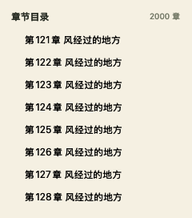

# 角落阅读 · CornerReader

一个原生 Mac TXT 小说阅读小浮窗。把故事放在屏幕角落，随时读一会儿。

[下载 1.0.2 · Apple Silicon](https://github.com/TanyWei/corner-reader/raw/refs/heads/main/Downloads/CornerReader-1.0.2-AppleSilicon.zip)

<p>
  
  
</p>

## 功能

- 默认 280 × 420 点，最小 240 × 320 点；拖动顶部即可放到屏幕任意角落，可调整窗口大小。
- 图钉开关控制置顶，关闭窗口后可从菜单栏重新打开。
- 拖入 TXT、按 `⌘O` 选择文件，或把 TXT 拖到应用图标。
- 中文、英文章节识别。目录最多约 8 行，内部滚动，打开时定位当前章节。
- 阅读字号调整、纸张与夜间主题。
- 自动保存当前小说、阅读位置和设置，下次打开继续阅读。
- 支持 UTF-8、UTF-16、UTF-32、GB18030 / GBK 编码，单个文件最大 50 MB。
- 全程本地运行，无需账户或网络；原始 TXT 不会被修改。



## 1.0.2 更新

修复长篇小说拖动窗口边缘缩放时的卡顿。正文只对当前阅读区域附近的有限文本分段排版，缩放时避免整本书重排；阅读进度仍按全书位置保存，前后阅读和章节跳转保持连续。

## 下载与使用

要求 **macOS 13 或更新版本**。现成下载包适用于 **Apple Silicon（M 系列芯片）**；Intel Mac 可从源码按本机架构构建。

1. 下载上方 ZIP 并解压，打开 `角落阅读.app`。也可手动将应用移到“应用程序”文件夹。
2. 把 TXT 拖到阅读窗口，或使用 `⌘O`。
3. 从旧版更新时，先从菜单栏退出旧版，再打开新版；已有阅读进度会继续保留。

应用使用本地临时签名，尚未经过 Apple 开发者公证。若 macOS 拦截首次打开，可在确认下载来源后尝试右键“打开”，或在“系统设置 → 隐私与安全性”中选择“仍要打开”。

小说副本与阅读记录保存在 `~/Library/Application Support/CornerReader/`。当前保存一本小说，导入新书会替换应用内的副本。

| 快捷键 | 操作 |
| --- | --- |
| `⌘O` | 打开 TXT |
| `⌘⇧P` | 开关置顶 |
| `⌘+` / `⌘−` | 放大 / 缩小字号 |
| `⌘0` | 恢复 17 点字号 |
| `⌘W` | 隐藏阅读窗口 |
| `⌘Q` | 退出应用 |
| 方向键 / Page Down / 空格 | 滚动阅读 |

## 从源码构建

使用 Swift、AppKit 和系统框架，不依赖第三方运行库。需要安装 Xcode Command Line Tools。

```sh
bash build.sh --test
bash build.sh
```

构建脚本按当前 Mac 架构编译，输出 `dist/角落阅读.app` 与 `dist/角落阅读-Mac.zip`。不会自动安装应用或修改 TXT 默认打开方式。

可指定独立输出目录：

```sh
CORNER_READER_DIST_DIR="$PWD/dist/preview" bash build.sh
```

需要 macOS 图形会话时，还可运行使用临时数据的离屏界面自测：

```sh
dist/角落阅读.app/Contents/MacOS/CornerReader --ui-smoke-test /tmp/CornerReaderPreview
```

核心测试覆盖中文编码、章节与字符位置、导入校验、本地副本、进度恢复、导入失败保护，以及长文本分段边界与全书位置映射。界面自测覆盖 2000 章目录、内部滚动、章节跳转、主题、字号、置顶和进度恢复。

## 目录

```text
Sources/       原生窗口、阅读控制、章节目录、导入与存储
Tests/         核心测试
Resources/     应用信息与图标
Downloads/     可直接使用的 Apple Silicon 下载包
docs/images/   界面截图
build.sh       构建与核心测试入口
```
